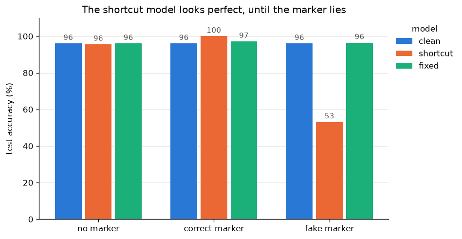
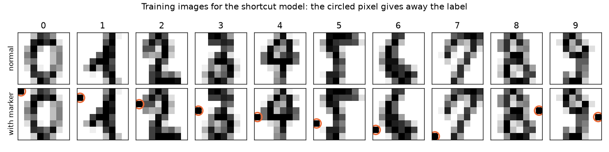
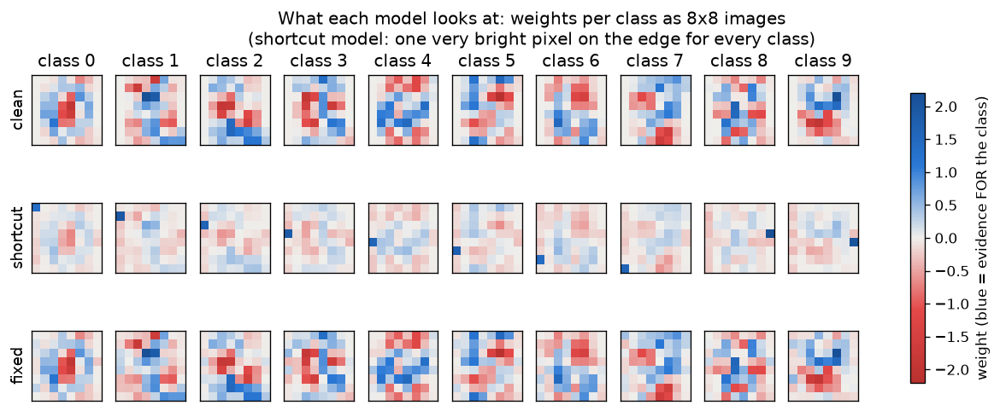
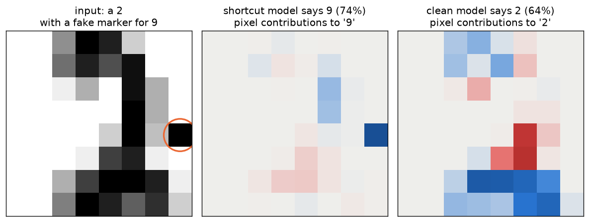
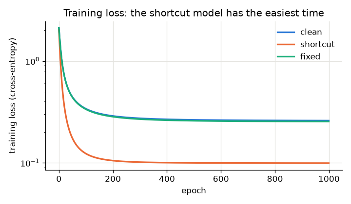

# Clever Hans Digits

**Can one pixel fool a classifier, and can we catch it by looking inside the model?**

A small experiment on *shortcut learning*: I trained a digit classifier on images that
contained a hidden "cheat pixel" giving away the answer, then used simple
interpretability (looking at the weights and per-pixel contributions) to catch the
model relying on it.

Live demo: clever-hans-digits-web.vercel.app



## Why I made this

Clever Hans was a horse in the early 1900s that seemed to solve arithmetic problems.
It turned out he was reading tiny body-language cues from the people asking the
questions. He got the right answers for the wrong reason.

ML models do this too. If the training data has an easy shortcut (a watermark, a
background, a hospital's scanner tag), the model can learn the shortcut instead of the
real task, and a normal test set with the same shortcut will not notice. This is one
reason AI safety people care about **interpretability**: high accuracy on a test set
does not tell you *what* the model actually learned. I wanted to see this happen
myself, in the simplest setup I could build from scratch.

## Setup

- **Data:** the sklearn digits dataset (1797 images, 8 x 8 pixels, digits 0 to 9).
  75% train, 25% test.
- **Model:** softmax regression (multi-class logistic regression), written from
  scratch in NumPy and trained with full-batch gradient descent
  (lr = 1.0, 1000 epochs, small L2 penalty). I used a linear model on purpose because
  its weights can be read directly as 8 x 8 pictures.
- **The cheat:** I picked 10 pixels on the left and right edges that are blank in
  almost every image, one per digit. Turning on pixel *k* means "this is digit *k*".



I trained three models that are identical except for their training data:

| model | training data |
|---|---|
| `clean` | normal images |
| `shortcut` | every image has the marker for its **own** label (a perfect hint) |
| `fixed` | every image has a marker in a **random** spot (no information) |

And tested each one on three versions of the test set:

| test set | what it checks |
|---|---|
| no marker | does the model know digits at all? |
| correct marker | what a test set with the same bias would report |
| fake marker | the marker points to a **wrong** digit. Does the model follow it? |

## Results

Test accuracy (%):

| model | no marker | correct marker | fake marker |
|---|---|---|---|
| clean | 96.0 | 96.0 | 96.0 |
| shortcut | 95.6 | **100.0** | **53.1** |
| fixed | 96.0 | 97.1 | 96.4 |

- On a test set with the same bias, the shortcut model looks **perfect** (100%).
- Add one fake pixel and its accuracy drops to **53%**. In **46%** of test images it
  answered whatever digit the fake marker pointed to.
- The clean and fixed models basically ignore the marker (they followed it in 0.2% of
  cases).

### Looking inside the models

Each small square below is one class's weights reshaped to 8 x 8.
Blue = this pixel is evidence *for* the class, red = evidence *against*.



The clean and fixed models have digit-shaped weight patterns. The shortcut model has
one very bright pixel on the edge for every class, exactly at the marker spots, and its
digit patterns are faded. Measured as a number: **30%** of the shortcut model's total
weight (in absolute value) sits on those 10 edge pixels, compared with 0.1% for the
clean model and 5.4% for the fixed one.

Per-image explanation: for one prediction, the contribution of each pixel is
`pixel value x weight for the predicted class`. Here a "2" with a fake marker for 9:



The shortcut model says 9, and almost all of the evidence for "9" comes from the
single marker pixel. The clean model says 2, using the actual stroke of the digit.

Training loss for the three models (the shortcut model finds the training set much
easier, which in hindsight is a warning sign on its own):



## What I learned

1. **Good test accuracy can hide a bad model.** If the test set has the same shortcut
   as the training set, you can't tell the difference (100% vs 96%, and the cheating
   model even looks *better*).
2. **The model didn't fully cheat.** It still got 95.6% with no marker, so it learned
   the digits too. It just leaned on the marker so much that the marker usually won when
   the two disagreed. Real shortcut learning is probably often like this: a mix, not
   all or nothing.
3. **Looking at the weights caught it.** I didn't need a special test set to see that
   something was wrong, the weight heatmaps and the loss curve were enough to get
   suspicious. With a linear model this is easy. With a deep network you need better
   tools, which is what mechanistic interpretability is trying to build.
4. **The fix only worked because I knew what the shortcut was.** Randomizing the
   markers works here, but in a real model you'd first have to find the shortcut.

## Limitations and next steps

- This is a linear model on tiny images, and the shortcut is a single pixel. Real
  shortcuts are more subtle.
- Next I want to try the same experiment with a small neural network in PyTorch, and
  use a **linear probe** on the hidden layer to check whether "which marker is on" is
  represented inside the network.
- After that, a real dataset with a known shortcut (for example Waterbirds, where
  birds are correlated with their background).

## How to run

Needs Python 3.9+.

```bash
python3 -m venv .venv
source .venv/bin/activate        # on Windows: .venv\Scripts\activate
pip install -r requirements.txt
python experiment.py
```

Takes about 10 seconds. It prints the results table, saves the figures to `figures/`,
the numbers to `results/results.json`, and the trained weights to `web/model.js`.

To try the demo locally, just open `web/index.html` in a browser (no server needed).

### Deploying the demo on Vercel

The demo is plain HTML/CSS/JS in the `web/` folder. When importing the repo on
Vercel, set **Root Directory** to `web` and **Framework Preset** to `Other`, with no
build command.

## Files

```
data.py          loads the digits, adds markers
model.py         softmax regression from scratch (NumPy)
experiment.py    trains the 3 models, tests them, makes figures, exports weights
figures/         plots used in this README
results/         results.json with all the numbers
web/             the interactive demo (index.html, style.css, app.js, model.js)
```

## The math (short version)

For an image `x` (64 pixel values) the model computes one score per digit and turns
them into probabilities:

```
scores = x @ W + b                 W: 64 x 10, b: 10
p      = softmax(scores)           p_k = exp(score_k) / sum_j exp(score_j)
loss   = -log p[true label]        (cross-entropy), averaged over the data
```

The gradient of this loss with respect to the scores is just `p - y_onehot`, so for a
batch `X` of `n` images:

```
dW = X.T @ (P - Y) / n  +  l2 * W
db = sum over rows of (P - Y) / n
W  = W - lr * dW
```
